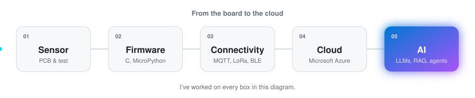
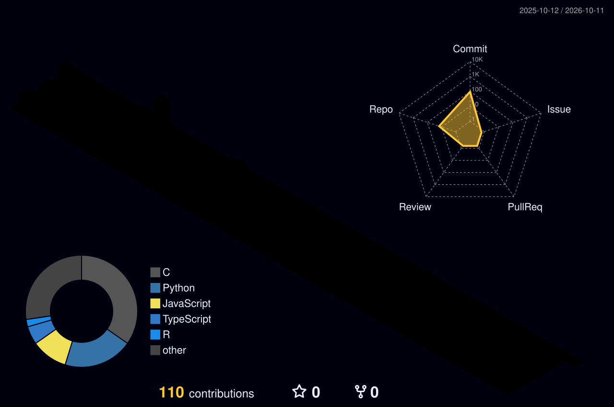

<div align="center">


### I build things from the board to the cloud.


[](https://www.linkedin.com/in/rafael-glez-chong/)
[](https://rafael-gonzalez.vercel.app/)
[](mailto:rafael.glez.chong@gmail.com)


</div>

## About me

I'm a Cloud Solution Architect at Microsoft, based in Mexico City. I help teams build on Azure and put AI to work in ways that hold up after the demo.

I didn't start in the cloud. My first job was as an electronics technician in Chihuahua, soldering and debugging IoT boards. From there I moved into firmware, QA, sales, an internship in Germany and systems integration, and every step got me a little closer to the customer and a little further up the stack.

```yaml
location: Mexico City, Mexico
role: Cloud Solution Architect at Microsoft
education: B.Sc. in Electronic Engineering
focus:
  - Azure architecture and AI services
  - Security and reliable platform design
  - Embedded systems, IoT, and full stack engineering
languages:
  - Spanish: Native
  - English: C1
  - German: A2
```

## From the board to the cloud

<picture>
  <source media="(prefers-color-scheme: dark)" srcset="./assets/flow-dark.svg">
  <source media="(prefers-color-scheme: light)" srcset="./assets/flow-light.svg">
  
</picture>

Most cloud architects start at the cloud. I started at the sensor, so when a customer says "the data looks weird", I know where to look.

## Selected projects

| Project | Impact | Main technologies |
|:---|:---|:---|
| [Pharmacy AI Automation](https://github.com/surbalo1/Pharmacy-AI-automation-system) | AI automation platform for pharmacy workflows, communication, and analytics | Python, AI, APIs |
| [AI Coaching System](https://github.com/surbalo1/ai-coaching-system) | Multi-agent workflows, a RAG knowledge base, and video processing behind one dashboard | Python, FastAPI, React, RAG |
| [IoT Sensor Pipeline](https://github.com/surbalo1/iot-sensor-pipeline) | Connects simulated sensors to a live dashboard through an end to end data pipeline | MQTT, Node.js, PostgreSQL, Docker |
| [ESP32 AC Motor Controller](https://github.com/surbalo1/esp32-ac-motor-controller) | Controls AC motor speed with phase angle modulation on ESP32 | C++, ESP32, control systems |
| [RSL10 and Arduino I2C](https://github.com/surbalo1/RSL10-Arduino-I2C-Communication) | Implements bidirectional communication between RSL10 and Arduino | C, I2C, embedded systems |
| [Real Time Emotion Recognition](https://github.com/surbalo1/real-time-emotion-recognition) | Detects facial emotions from a webcam and displays live results | Python, OpenCV, Streamlit |
| [UT Austin Big Data Analysis](https://github.com/surbalo1/ut-austin-big-data-analysis) | Applies data management, statistics, and predictive analysis to coursework projects | R, Python, SQL |

<details>
<summary><b>More embedded, IoT, and AI projects</b></summary>

### Embedded systems

- [Embedded BSP for ESP32 and PIC18F](https://github.com/surbalo1/embedded-bsp-esp32-pic18f)
- [MSP430 and Arduino UART Bridge](https://github.com/surbalo1/msp430-arduino-uart-bridge)
- [RSL10 ADC VDDC Monitor](https://github.com/surbalo1/rsl10-adc-vddc-monitor)
- [RSL10 SysTick Timestamp](https://github.com/surbalo1/RSL10-SysTick-Timestamp)
- [RSL10 UART LED Control](https://github.com/surbalo1/RSL10-UART-LED-Control)

### IoT and software

- [ESP32 Weather Client](https://github.com/surbalo1/esp32-weather-client)
- [Sensor Dashboard](https://github.com/surbalo1/sensor-dashboard)
- [Multi Personality Chatbot](https://github.com/surbalo1/multi-personality-chatbot)

</details>

## Technology toolkit

<div align="center">


<br/>


</div>

## Journey

<picture>
  <source media="(prefers-color-scheme: dark)" srcset="./assets/journey-dark.svg">
  <source media="(prefers-color-scheme: light)" srcset="./assets/journey-light.svg">
  
</picture>

### Experience highlights

| | Role | Organization | Focus |
|:---:|:---|:---|:---|
| ☁️ | Cloud Solution Architect | Microsoft | Azure, AI, security, solution clarity |
| 💻 | Operations Technology | Hash Marketing MX | Frontend, APIs, automation |
| 🔧 | Systems Integration Engineer | IMTECH Desarrollos | MSP430, RSL10, validation |
| 🌍 | Electrical Engineer Intern | BALSAS GmbH | DIN VDE projects in Germany |

## Education and credentials

| 🎓 Electronic Engineering | 🌎 Fulbright COMEXUS Scholar |
|:---:|:---:|
| Chihuahua Institute of Technology | Big Data and AI at UT Austin |

<div align="center">


### Currently learning


</div>

## Latest activity

<!--START_SECTION:activity-->
1. 🔨 Pushed 1 commit to [surbalo1/personal-website](https://github.com/surbalo1/personal-website)
2. 🔀 Merged PR [#1](https://github.com/surbalo1/surbalo1/pull/1) in [surbalo1/surbalo1](https://github.com/surbalo1/surbalo1)
3. 🔨 Pushed 1 commit to [surbalo1/surbalo1](https://github.com/surbalo1/surbalo1)
4. 🔀 Opened PR [#1](https://github.com/surbalo1/surbalo1/pull/1) in [surbalo1/surbalo1](https://github.com/surbalo1/surbalo1)
5. 🔀 Merged PR [#10](https://github.com/surbalo1/personal-website/pull/10) in [surbalo1/personal-website](https://github.com/surbalo1/personal-website)
6. 🔀 Opened PR [#10](https://github.com/surbalo1/personal-website/pull/10) in [surbalo1/personal-website](https://github.com/surbalo1/personal-website)
<!--END_SECTION:activity-->

## GitHub activity

<div align="center">


<br/>


<br/>



<picture>
  <source media="(prefers-color-scheme: dark)" srcset="https://raw.githubusercontent.com/surbalo1/surbalo1/output/github-snake-dark.svg">
  <source media="(prefers-color-scheme: light)" srcset="https://raw.githubusercontent.com/surbalo1/surbalo1/output/github-snake.svg">
  
</picture>

</div>

## Let's build something

Whether it's about Azure, AI, or something you're building with hardware, my inbox is open.

- [LinkedIn](https://www.linkedin.com/in/rafael-glez-chong/)
- [Portfolio](https://rafael-gonzalez.vercel.app/)
- [Email](mailto:rafael.glez.chong@gmail.com)

<div align="center">


</div>
